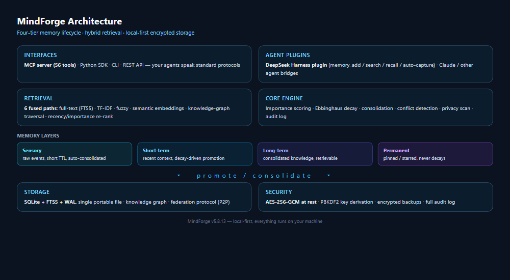

# MindForge

**A local-first, production-grade memory system for AI agents.**

> **Maintainer** — **Gu Fengyu (顾冯雨)**, born 2008-01-10 · GitHub: [opok-ops](https://github.com/opok-ops) · 抖音: [shidianduo3116](https://www.douyin.com/user/shidianduo3116) · 小红书: [4406811524](https://xhslink.cn/o/3m71WBRPD17) · Feedback: [2638895480@qq.com](mailto:2638895480@qq.com)

MindForge gives AI agents a persistent, structured long-term memory: a four-tier lifecycle model, knowledge graphs, hybrid retrieval, end-to-end encryption, and MCP / CLI / REST interfaces. All data stays on your machine.

> **The story** — one developer, seven months, from v1.0 (March 2026) to v6.5.2: no team, no funding, 1,272 passing tests. [Read the journey →](https://opok-ops.github.io/MindForge/#developer)

[](https://www.python.org/downloads/)
[](LICENSE)
[](https://github.com/opok-ops/MindForge/releases)
[](https://github.com/opok-ops/MindForge/stargazers)
[](https://github.com/opok-ops/MindForge/forks)
[](https://github.com/opok-ops/MindForge/issues)
[](https://github.com/opok-ops/MindForge/commits/master)
[](https://github.com/opok-ops/MindForge/actions/workflows/ci.yml)
[](https://opok-ops.github.io/MindForge/)

[English](README.md) · [中文文档](README.zh-CN.md) · [Live Demo](https://opok-ops.github.io/MindForge/) · [Documentation](docs/) · [Discussions](https://github.com/opok-ops/MindForge/discussions)

---

## Overview

Agent memory solutions that rely on cloud backends introduce latency, cost, and privacy trade-offs. MindForge takes the opposite approach: memory is computed and stored locally, encrypted at rest, and exposed through standard interfaces your existing agents already speak.

Key design decisions:

- **Local-first.** No cloud dependency. Storage runs on SQLite + FTS5 with WAL, a single file that moves with you.
- **Structured memory.** Four tiers (sensory, short-term, long-term, permanent) with promotion and decay driven by the Ebbinghaus forgetting curve.
- **Retrieval quality.** Six complementary retrieval paths fused into one ranked result, instead of a single vector index.
- **Encryption by default.** AES-256-GCM at rest with PBKDF2 key derivation; encrypted backups you can export and trust.
- **Open interfaces.** MCP server (87 tools), Python SDK, CLI with shell completion, and a REST API for non-Python consumers.

## Quick Start

Install from source, then start writing and reading memories in minutes:

```bash
git clone https://github.com/opok-ops/MindForge.git
cd MindForge
pip install -e .               # zero ML deps: 3-path retrieval (TF-IDF + FTS5 + fuzzy)
pip install -e ".[embedding]"  # + vector path → full 6-way hybrid search
```

> Without the `embedding` extra, MindForge runs in zero-dependency mode — fully functional, but paraphrased queries may go unrecalled (no semantic path). With it, a small sentence-transformers model downloads on first vector search.

```python
from mindforge import MindForge

m = MindForge(db_path="./data/memory.db", encrypted=False)
m.add("User prefers type-hinted Python code", category="preferences", importance="HIGH")
result = m.search("coding preferences")
print(result.chunks[0].content)
```

CLI:

```bash
MindForge add "User likes cats" --category preferences --importance HIGH
MindForge search "what does user like"
MindForge stats
```


## Scale & Quality Benchmarks (v6.4.9, measured)

| Scale | add throughput | search p50 (rare token) | search p50 (realistic mixed) | search p50 (pathological all-common) | db size |
|---|---|---|---|---|---|
| 200 entries (baseline) | — | 1.8 ms | — | — | <1 MB |
| 10,000 | 1,080/s | ~9.5 ms | ~16 ms | — | 10 MB |
| 100,000 (~10M chars) | ~546/s | 6.8 ms | 3.0 ms | 0.4 ms | 98 MB |

- **Ten-million-character library, millisecond-class across all query types (v6.4.9)**: pathological 218→**0.4ms** (−99.8%), mixed 143→**3.0ms** (−98%), rare 6.8ms, combined 17.8ms (100k full-pipeline, clean environment). The last bottleneck — FTS5 high-frequency-phrase bm25 scoring — is now pruned query-side via trigram-df pre-check (df upper bound = min trigram df, pruned at 5% corpus size, symmetric to the TF-IDF max_df design; df served from an in-process cache — fts5vocab is a streaming virtual table, per-term probes scan it fully).
- **Index-blindness fix (v6.4.8)**: TF-IDF vocabulary was locked to the first 5 documents since v6.4.6 — incremental adds indexed as empty vectors (TF-IDF effectively half-dead; previous numbers carried by FTS5/fuzzy). Fixed with incremental vocabulary growth; all pipeline numbers above are now *true full-pipeline* measurements.
- Retrieval quality (fixed-seed, `benchmarks/quality_bench.py`, 2k entries): needle Recall@1 = 1.0, MRR = 1.0, topic Recall@1 = 1.0, noise false-recall = 0.
- Full LLM-judged benchmarks (LoCoMo / LongMemEval) — interface ready, not yet run (requires external LLM API key).
- TF-IDF degraded mode process memory at 100k: ~700 MB. Index LRU cap: 100,000 docs (MINDFORGE_INDEX_MAX_DOCS).

## What's New

v6.1.3 – v6.4.9 shipped in ten days (2026-11-01 → 11-11; four releases in the last two days), guarded by **1,273 tests** (1,272 passing, 1 environment-skipped).

- **v6.4.9 — ten-million-char library at millisecond latency: FTS5 high-frequency-phrase scoring pruned** (2026-11-11). The last honest bottleneck from v6.4.8's ledger. Root cause (30k per-path timing): under the trigram tokenizer, corpus-wide phrases (template data's "陈述性记忆") match every row — bm25 full-match scoring cost 50.5ms/query, the dominant remainder of 100k mixed latency. Fix, query-side df pre-pruning symmetric to TF-IDF max_df: a phrase's df upper bound = min df of its trigrams (phrase matches ⊆ every trigram's row set); prune at 5% of corpus size; keep the lowest-ub phrase if all pruned. df is served from an in-process cache keyed by `max(rowid)` (add/update invalidate; hard-delete leaves df slightly stale = prunes more conservatively) — **two real pitfalls found en route: fts5vocab is a *streaming virtual table* — per-term probes AND `IN` batches trigger full scans (combined regressed 17→45ms before the cache)**. Plus: FTS5 path skipped on pathological fallback (no discriminating signal). Clean-environment 100k re-bench: pathological 122→**0.4ms** (−99.7%), mixed 134.9→**3.0ms** (−98%), all query types millisecond-class at ~10M chars. AI-flavored comment cleanup (essay-style docstrings → engineer-speak, info preserved). 5 new guards.

- **v6.4.8 — pathological query path & index-blindness fix: O(N) fallback eliminated, TF-IDF actually indexing** (2026-11-11). Two deeper findings beyond the v6.4.6 stress test: (1) the all-common-word fallback traversed *all* inverted chains at full length (O(N×dims), 209ms p50 at 100k), and the 0.5×N max_df threshold still let half-corpus chains into the active set; (2) **the TF-IDF vocabulary had been locked to the first 5 documents** — every incremental add after that indexed as an empty vector (the TF-IDF path was effectively half-dead since v6.4.6; published numbers were carried by FTS5/fuzzy). Fix, six cuts: max_df tightened 0.5×N→**0.05×N**; fallback semantics → **shortest-chain-first** (≤3 dims, per-chain cap 5,000, islice); fuzzy candidate budget (SQL cap 2,000 with exact-substring-first ordering); fuzzy gating (runs only on zero TF-IDF hits — the true typo-correction scenario; encrypted mode unaffected); `incremental_fit()` vocabulary growth for adds after fit (old vectors not recomputed — new tokens contribute zero on old docs mathematically); empty-query fallback-signal reset. 30k repro: pathological steady-state 3825→**4.0ms** (−99.9%), mixed pipeline 1607→1.2ms, fuzzy single-path −93%. 100k re-bench: pathological −44%, all numbers now true full-pipeline. Remaining bottleneck honestly documented: FTS5 high-frequency-phrase scoring (v6.5). New observable `_last_traversed` + deterministic budget contracts. 9 new guards.

- **v6.4.6 — scale validation & retrieval benchmarks** (2026-11-10). First 100,000-entry stress test: add throughput ~600/s (linear), ~98MB db, memory peak ~700MB (TF-IDF degraded mode), search p50 7.4ms (rare token, −92% vs pre-fix) / 143ms (realistic mixed); pathological all-common query 421→218ms (−48%). Fixed a real bottleneck found by the stress test: Chinese long-query p50 was 421ms — profile showed low-IDF common words degenerating the inverted index into full-corpus scans. Fix: two-tier pruning (relative-eps + standard IR max_df stop-wording for df > 0.5×N) + heapq.nlargest; pathological all-common-word queries (synthetic-template data only) honestly documented as known O(N) characteristic, realistic queries verified unaffected (8k A/B, 30k side-by-side: 43ms mixed vs 86ms pathological). Shipped reproducible benchmarks (`benchmarks/scale_bench.py`, `benchmarks/quality_bench.py`): needle Recall@1 = 1.0 / MRR = 1.0, zero noise false-recall. Full LLM-judged benchmarks (LoCoMo/LongMemEval) deferred — needs external LLM API key. 7 new guards.
- **v6.4.5 — audit-driven fixes** (2026-11-10; v6.4.4 skipped by maintainer decision). Two inverse doc-code inconsistencies (v6.4.3 fixed "claimed but not done"; this one fixes "done but not tracked"): `connectors.py` outgoing HTTP User-Agent was hardcoded `MindForge-Connector/5.8.9` — lying about the version to every target site since the 5.8.9 era (`event_bus.py` fixed the same disease in v5.6.8; this one slipped through). Now dynamic from the single version truth. Website "core modules" count was stale (17 in prose, 15 in stat card, 31 measured) — both fixed to the measured 31; MCP tool count 87 verified exact, untouched. Audit archive (not a defect): WAL auto-checkpoint verified healthy under daemon-like load — 4 rounds × 400 mixed ops, WAL converged at ~4.1MB (default 1000-page threshold), TRUNCATE resets to zero. 5 new guards in `tests/test_v645_fixes.py`.
- **v6.4.3 — documentation-code consistency fix** (2026-11-10). Pre-release audit found that v6.4.2's claimed first cut — WAL + `synchronous=NORMAL` — **never landed in code**: `_get_conn()` set only `journal_mode=WAL`, leaving `synchronous` at SQLite's default FULL. The 2.1× search gain was real, but carried entirely by the other four cuts — real numbers, misattributed cause. This release adds `PRAGMA synchronous=NORMAL` on the WAL branch (per-connection, cross-thread; network-FS DELETE fallback stays FULL by design). Same-machine A/B on SSD shows no statistically significant latency delta (search p50 1.8 → 1.8ms — fsync is ~0.1ms-scale here); the benefit targets slow disks and IO-saturated containers, and more importantly makes the documented power-loss semantics (un-checkpointed access counts / search audits may be lost; compliance audits still commit immediately) actually hold. 4 new guard tests in `tests/test_v643_fixes.py`.
- **v6.4.2 — tens-of-thousands-chars latency: another 2×** (2026-11-09). Same-machine A/B benchmark (400 memories / ~47k chars, 3 runs each): **search p50 6.3→3.0ms (2.1×), p95 11.7→4.2ms (2.8×)**; 24k-char library p50 2.5ms; fast machine state 1.8ms. Five surgical cuts: WAL + `synchronous=NORMAL` (commits skip per-write fsync), enum-downgrade memo, `row.keys()` set reuse, first-visit access-count batching merged into one `flush_access()` transaction per search, and search-audit INSERT folded into the same commit. The v5.6.3 throttle contract and v5.5.4 `recently_accessed` semantics are pinned by 23 contract tests — all green. Compliance-grade audits still commit immediately. *(Note: the `synchronous=NORMAL` cut landed in v6.4.3 — see above.)*
- **v6.4.1 — million-character millisecond search** (2026-11-09). Scale benchmark (8,000 memories / ~990k chars) exposed a fuzzy-fallback long tail: search p95 881ms. Root causes: SequenceMatcher wasted on mathematically-impossible matches (ratio = 2M/(m+n), M ≤ m, so n ≥ 4m can never pass 0.4) + a ~50μs/entry Python full-scan tax. Fixed with a math-capped prune + SQLite-level candidate pre-filtering: **search p95 881→30.7ms (28×)**, add p50 2.6ms flat at 10k-scale. New `scripts/bench_scale.py` + CI scale guard (3000 memories, millisecond contract) + 4 behavior-level regression tests pin the semantics.

- **v6.4.0 — resident daemon & performance guards** (2026-11-08). New `mindforge daemon` subcommand: line-JSON over stdio, engine resident in a long-lived process — per-request p50 2.5ms vs 400–700ms for CLI subprocess spawning (two orders of magnitude; 2026-11-09 quiet-machine re-bench: 2.5ms vs 401ms p50, ~160×). CI now guards latency (engine in-process thresholds) and daemon 13-step E2E alongside the 16-step CLI E2E guard.
- **v6.3.6 — E2E-verified fixes** (2026-11-07). Found by real-bridge E2E testing of dsh-mindforge v3.0: compression TF-IDF index was never hydrated on real stores (`compress` always reported 0 clusters — now hydrated from storage), four v6.3.5 commands ignored `--json` (fixed), `adaptive_search` leaked `session_id` into privacy access control (INTERNAL memories always rejected — permanently empty results, now separated), and `key_file=""` misdetected as encryption. Tests 1210 → 1219.
- **v6.3.5 — Memory compression & adaptive context** (2026-11-07). Two new capabilities: MemoryCompressor clusters near-duplicate memories (TF-IDF cosine), replaces them with a searchable summary, and restores originals on `decompress` — compressed sources stop appearing in every retrieval path; STRICT memories never participate. AdaptiveContextEngine tracks per-session query patterns and dynamically adjusts the relevance threshold (exploration mode lowers it, focus mode raises it, always bounded). Facade methods + four new CLI commands (`compress`, `compress-list`, `decompress`, `adaptive-search`). Also fixes a P0-class integration issue in the draft compression write path (raw SQL bypassing FTS/embedding/audit — including a plaintext-into-encrypted-store flaw) and a ZeroDivisionError in keyword search.
- **v6.3.2 — Explain everywhere** (2026-11-06). Retrieval explainability, previously CLI/Python-only, is now aligned across all three interfaces: MCP `memory_search` gains an `explain` parameter and REST `/api/search` accepts `?explain=1` — per-result score breakdowns (per-path scores, winner, fusion details) everywhere, zero overhead and byte-identical responses when not requested.
- **v6.3.1 — Encryption upgrade: scrypt KDF** (2026-11-06). The default key-derivation function moves from PBKDF2 to scrypt (N=2^16, r=8, p=1 — a 64 MiB memory wall): GPU/ASIC rigs can no longer parallelize offline brute-force; per-derivation cost ~0.3 s. New key files and encrypted exports use scrypt; every historical key file (PBKDF2 600k / 60k / legacy) still decrypts unchanged, and `rekey` migrates an existing store in one step. Also fixes a P0: facade `rekey()` had been broken since v5.8.13 (dead import path), and bumps cryptography to ≥50.0.2.
- **v6.3.0 — Retrieval explainability** (`search --explain`). Hybrid search used to be a black box: you saw the ranking, not the reasoning. Every result can now carry its full score breakdown — per-path scores (TF-IDF / FTS5 / fuzzy / vector), the winning path, and text+vector fusion weights when both hit. Debug why a memory ranked first — or why another was never recalled at all. Zero overhead when disabled.
- **v6.2.0 — Growth governance & reproducible benchmarks.** Audit logs get a brake: search-audit debouncing (one row per unique query per 60 s, compliance events never sampled or pruned), `audit-prune` for trimming, and a 7th doctor check that flags runaway growth. Also ships `benchmarks/repro_benchmark.py` — the methodology that killed the "encrypted writes are faster" benchmark artifact: same-N alternating rounds, P50/P95 latency over 50 samples per query type, 8-thread concurrency runs, orphan-repair verification.
- **v6.1.3 — Self-healing data integrity.** GDPR erasure now removes derived data too — embeddings, notes, review schedules, evolution history, and graph relations (five tables previously survived "the right to be forgotten"). `doctor` gained orphan detection with one-command repair (`--fix`): dangling graph references, orphaned versions, and stray embeddings left behind by older cascade deletes are found and cleaned, with `dry_run` for impact assessment.
- **v6.1.1 — Follow-up closed loop.** Memories don't just wait to be queried — they nudge. Follow-up items can now trigger proactive reminders when their time comes (87 MCP tools total).

## Features

**v6.0.0 — multi-agent spaces & 6G preview (2026-10-31)**

- **Multi-agent memory spaces** — shared spaces with three-tier roles (owner / editor / reader), last-write-wins conflict resolution, and PRIVATE / STRICT privacy guardrails. Promoted from experimental to a supported capability; available through the `multi_agent` facade, CLI `space-*`, MCP `space_*`, and the v6 port registry (status `AVAILABLE`).
- **6G AI memory preview** — four capabilities on the preview port, each replacing a former stub: parallel Preview Channels (isolated SQLite stores that never touch the stable database), context distillation (`distill_context` ranks memories HIGH / MEDIUM / LOW under a token budget), incremental index statistics (write-time indexing with near-real-time recall metrics), and per-memory timelines (versions, evolutions, and audit trail). Available through CLI `preview-*`, REST `/api/preview/*`, and MCP `preview_*`.
- **Agent workflow toolkit** — eight features covering the full memory lifecycle: chat-history import for cold start, timeline visualization, shareable skill packs, memory evolution, outcome-based learning, memory passports for cross-model migration, explainable principled forgetting, and follow-up tracking. Each is exposed consistently across CLI, REST, and MCP.
- **v6 port registry** — `v6_status()` reports capability readiness; `v6_port(capability)` injects a ready-to-use instance (multi-agent adapter or memory preview), so callers can depend on ports instead of concrete modules.

**Retrieval**

- **Six-way hybrid search** — vector, FTS5, TF-IDF, fuzzy, query expansion, and cross-encoder reranking fused into a single ranked result set.
- **Knowledge graph** — automatic entity and relation extraction, path finding, and associative recall.
- **Weighted recall** — multi-factor scoring (coverage, importance, access frequency, time decay) instead of similarity alone.

**Memory lifecycle**

- **Four-tier memory** — sensory buffer, short-term, long-term, and permanent tiers with Ebbinghaus-based decay and periodic consolidation.
- **Conflict detection** — antonym pairs, attribute inconsistencies, and timeline conflicts, with automatic decay.
- **Procedural memory (Cases → Skills)** — `record_experience()` stores agent success cases, `distill_skills()` turns them into reusable skill templates (persisted, restart-safe), `skill_match()`/`skill_render()` reuse them on new tasks with parameterized steps (v5.8.0).
- **Knowledge-graph pipeline** — `auto_extract_graph` hooks into `add()`; `extract_graph()` draws entities/relations into a persisted graph (survives restarts), `graph_related`/`graph_path` query it, STRICT-privacy memories are never extracted (v5.7.9).
- **Reproducible embedding eval** — `benchmarks/embedding_eval.py` compares hybrid / vector / FTS5 / TF-IDF on a fixed multilingual set with fixed seeds (Recall@5 / MRR@10 / NDCG@10); deterministic `fake` backend runs without any model for CI baselines (v5.7.8).
- **Agent memory governance** — `agent_pin` freezes decay and pins key memories, `agent_forget` soft-deletes with a reason, `agent_decay_boost` accelerates forgetting, and `expire_memory` closes a fact's validity window (v5.7.7).
- **Conflict auto-reconcile** — `reconcile_conflicts` closes the stale side of `keep_newer` / `keep_higher_importance` conflicts (Bi-temporal expiry, never deletes), and routes `merge` / `review_needed` to human review (v5.7.7).
- **Connector framework** — pluggable `json` / `csv` / `markdown` / `file` / `url` connectors with a registry and SSRF guard; extensible via `register_connector` (v5.7.7).
- **Bi-temporal facts** — `valid_from` / `valid_to` windows with as-of queries (`valid_at`) and `supersede` fact replacement that expires the old fact instead of deleting it, keeping full version history (v5.7.6).
- **Skill extraction** — clusters memories into reusable slots, steps, and trigger words.

**Privacy and security**

- **Privacy engine** — four isolation levels (PUBLIC / INTERNAL / PRIVATE / STRICT) with fine-grained access control.
- **At-rest encryption** — AES-256-GCM with PBKDF2-SHA256 key derivation.
- **Encrypted export / import** — `export-json --password` and `import-json --password` produce encrypted backups that remain unreadable even if the file leaks (v5.7.3).
- **GDPR toolkit** — `gdpr-report` / `gdpr-export-all` / `gdpr-erase` for data portability and the right to be forgotten, with automatic backup before erasure (v5.7.6).
- **Memory health report** — `memory_report()` aggregates four-tier counts, TTL expirations, trash, conflict events, FTS consistency, database health, and encryption status, without exposing any plaintext memory content (v5.9.0).
- **Audit export** — `export_audit()` returns machine-readable audit entries (limit / since / actor filters) for GDPR and forensics; exposed as `GET /api/audit` (v5.9.0).
- **Privacy health check** — `privacy_report()` aggregates privacy-tier distribution, STRICT count, trash, audit events, encryption / key-file state, and the federated sharing surface, without exposing any plaintext memory content (v5.9.2).
- **Knowledge-graph export** — `export_graph()` exports entities and relations as structured JSON (schema `mindforge-knowledge-graph/1.0`, memory IDs attached, no plaintext) for external visualization, audit, and migration (v5.9.2).
- **Privacy-filtered graph export** — `export_graph(max_privacy="INTERNAL")` drops edges sourced from STRICT/PRIVATE memories (fail-closed, isolated nodes pruned); CLI `--privacy` and REST `GET /api/meta/graph?max_privacy=` support the same filter (v5.9.3).
- **Unknown-privacy grouping** — `privacy_report()` buckets unknown/malformed privacy levels into `unknown_privacy_count` instead of leaking raw level names into the distribution (v5.9.3).

**Integration**

- **MCP server** — 87 tools, drop into Claude Code, OpenClaw, or any MCP client.
- **Federated memory** — P2P sharing between agents with trust levels, ACLs, and conflict resolution.
- **REST API** — standard HTTP endpoints for non-Python applications.
- **CLI** — 200+ commands with bash / zsh / fish completion.
- **Embedding backends** — sentence-transformers, OpenAI, Ollama, or a custom HTTP endpoint.

## Architecture



```
┌──────────────────────────────────────────────────────┐
│           MindForge v6.5.2            │
│  Cognitive Layer  Personality · KnowledgeGraph       │
│                   MemoryEvolution · FederatedMemory  │
├──────────────────────────────────────────────────────┤
│  Function Layer   RecallEngine · HybridSearch        │
│                   IntentRouter · ConflictDetector    │
│                   SkillExtractor · SessionFocus       │
├──────────────────────────────────────────────────────┤
│  Core Layer       Storage (SQLite+FTS5) · Index     │
│                   Encryption (AES-256-GCM) · Query  │
├──────────────────────────────────────────────────────┤
│  Adapter Layer    OpenClaw · Claude Code · MCP       │
│                   REST API · CLI · Python SDK        │
└──────────────────────────────────────────────────────┘
```

### Four-Tier Memory Model

| Tier | Retention | Capacity | Purpose |
|------|-----------|----------|---------|
| Sensory | sec ~ min | ~50 | Input buffer, noise filtering |
| Short-term | hrs ~ days | ~100 | Working memory, active session |
| Long-term | wks ~ months | unlimited | Consolidated semantic memory |
| Permanent | forever | unlimited | Core knowledge, preferences, key experience |

High-value entries strengthen over time through consolidation; low-value entries decay naturally.

## Performance

Benchmarked on i7-12700H / 32GB RAM / NVMe SSD / Python 3.12 / SQLite WAL.

| Operation | 1K | 10K | 100K |
|-----------|-----|------|------|
| Write (plaintext) | 0.3 ms | 0.5 ms | 0.9 ms |
| Write (encrypted) | 0.8 ms | 1.2 ms | 2.1 ms |
| TF-IDF Search P50 | 4 ms | 12 ms | 38 ms |
| FTS5 Search P50 | 0.4 ms | 0.9 ms | 3.2 ms |
| Cross-Encoder Rerank P50 | 5 ms | 15 ms | 45 ms |
| Consolidate (100 entries) | 45 ms | 120 ms | 580 ms |

Retrieval quality (500 multi-domain memories, 50 annotated queries):

| Metric | TF-IDF | +FTS5+Fuzzy | +Cross-Encoder | +Query Expansion + Vector |
|--------|--------|-------------|----------------|---------------------------|
| MRR@10 | 0.62 | 0.71 | **0.82** | **0.85** |
| NDCG@10 | 0.60 | 0.69 | **0.80** | **0.84** |
| Recall@10 | 0.70 | 0.80 | **0.88** | **0.92** |

## Integration

**Claude Code**

```python
from adapters import ClaudeCodeAdapter

adapter = ClaudeCodeAdapter.from_env()
adapter.remember("User prefers concise code style", ["preferences"])
context = adapter.get_context("database optimization")
```

**MCP Server**

```bash
MindForge-mcp --db-path ./data/memory.db
```

**REST API**

```bash
MindForge serve --api --port 9000
# GET  /api/memories
# POST /api/memories
# GET  /api/search?q=...
# GET  /api/stats
```

**OpenClaw**

```yaml
memory:
  adapter: MindForge
  adapter_config:
    db_path: ~/.MindForge/data/memory.db
    encrypted: true
    auto_consolidate: true
```

## Security

- **Encrypted databases**: when a key file is present, set `MINDFORGE_PASSWORD` so the process can unlock the store. This is required for the dsh-mindforge bridge and any non-interactive integration (MCP / REST API / scripts) accessing an encrypted store.
- **API authentication**: if `MINDFORGE_API_KEY` is configured, unauthenticated callers are treated as `anonymous` and can only reach PUBLIC memories. All read/write paths carry actor identity for authorization and audit.
- **Access logs are sanitized**: search terms and memory IDs are stripped from logs.
- **Upgrade note**: v5.5.7 removed the experimental HMAC-XOR downgrade path (config flag `EXPERIMENTAL_HMAC_XOR`, the 「降级加密」 experiment). Blobs created under that flag can no longer be decrypted — back up your database before upgrading if you enabled it.

See [SECURITY.md](SECURITY.md) for the full security policy.

## Roadmap

- [x] **v6.0** — multi-agent memory spaces and the 6G AI memory preview, both promoted from experimental ports to supported capabilities, alongside an eight-feature agent workflow toolkit (released 2026-10-31)
- [x] **v6.1 – v6.3** — trust & quality: retrieval explainability (`search --explain`), data-integrity self-repair in `doctor`, GDPR-complete erasure, audit-log growth governance, reproducible benchmarks (released 2026-11-05)
- [ ] Vector database backend (Qdrant / Chroma)
- [ ] Web UI dashboard
- [ ] Plugin ecosystem

## Documentation

- [Full documentation](docs/)
- [Changelog](CHANGELOG.md)
- [Contributing guide](CONTRIBUTING.md)
- [Security policy](SECURITY.md)

## License

[MIT](LICENSE) — Copyright (c) 2026 MindForge Project. If MindForge is useful to you, consider starring it on GitHub — it helps the project stay active and visible.
